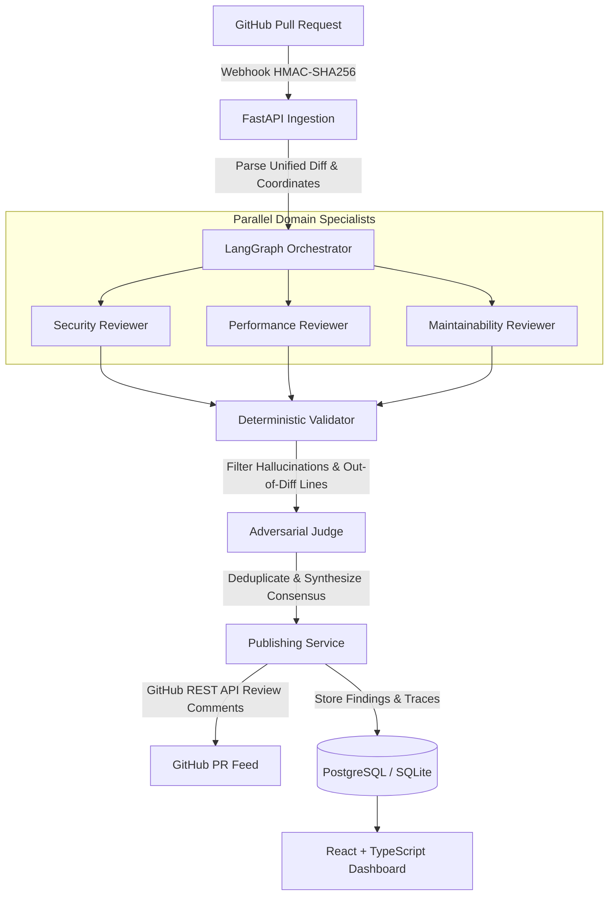

# CodeCourt

[](https://github.com/PUNNAMCHAND-T/CODECOURT/actions)


**CodeCourt** is an asynchronous, multi-agent code review platform that automates GitHub Pull Request analysis. Rather than relying on monolithic single-prompt LLM reviews—which frequently generate vague commentary, duplicate findings, and hallucinated line numbers—CodeCourt decomposes code review into specialized domain agents coordinated through a stateful directed graph, backed by deterministic coordinate validation and an adversarial judge synthesis layer.

---

## Key Highlights

- **Parallel Specialist Reviewers:** Independent, domain-focused reviewer agents analyze the diff concurrently:
  - **Security Agent:** OWASP Top 10, CWE patterns, hardcoded secrets, injection vectors, and broken access controls.
  - **Performance Agent:** Asymptotic time/space complexity, $O(N)$ database query anti-patterns, memory overhead, and unclosed connection leaks.
  - **Maintainability Agent:** Architectural boundary violations, SOLID principles, dead code paths, and typing consistency.
- **Deterministic Coordinate & Diff Grounding:** Every finding emitted by an LLM is verified against the unified diff hunk boundaries. If a finding references lines outside the modified range or hallucinates non-existent coordinates, it is programmatically repaired or dropped before publication.
- **Judge Agent Synthesis:** An adversarial Judge node resolves cross-agent disagreements, deduplicates overlapping findings across domain boundaries, and normalizes severity scores (`critical`, `high`, `medium`, `low`).
- **Production Guardrails & Cost Accounting:** Per-review token budget caps, tenant-level daily spending limits, circuit breakers, and constant-time HMAC-SHA256 webhook authentication.
- **Built-in Empirical Evaluation Suite:** Includes an automated benchmark harness measuring Precision, Recall, and False Positive Rates across three architectures: *Single-Agent Baseline*, *Multi-Agent without Judge*, and *Multi-Agent with Judge*.

---

## Architecture Overview



### Review Pipeline Stages

1. **Ingestion & Validation:** Receives GitHub `pull_request` webhooks, verifies HMAC-SHA256 signatures, enforces delivery idempotency, and fetches the PR metadata and unified diff via bounded retries.
2. **Context Preparation:** The diff is parsed into structured files and hunks with exact line mappings. Repository files are selectively fetched on demand via internal repository tools.
3. **Parallel Domain Evaluation:** Specialist prompts run concurrently using isolated LLM instances (Google Gemini API with automatic fallback to local test fakes).
4. **Deterministic Finding Verification:** Validates line numbers against actual modified hunk coordinates, checks evidence substrings against source files, and verifies severity classification schemas.
5. **Judge Consensus & Deduplication:** Merges redundant observations from multiple agents into single actionable items with synthesized remediation recommendations.
6. **Publication & Persistence:** Posts consolidated line-level review comments via GitHub's Pull Request Review API and persists complete audit trails, execution latency, and token expenditures.

---

## Technology Stack

| Layer | Technologies |
| :--- | :--- |
| **Backend Framework** | Python 3.11+, FastAPI, Pydantic v2, Pydantic-Settings |
| **Agent Orchestration** | LangGraph (Stateful Graph Execution), Async HTTP Client (`httpx`) |
| **Database & ORM** | PostgreSQL 16 / SQLite (`aiosqlite` for zero-dependency local runs), SQLAlchemy 2.0 (Async), Alembic |
| **Frontend Application** | React 19, TypeScript, Vite, Tailwind CSS v4, Lucide Icons |
| **Observability** | OpenTelemetry-compatible tracing, Langfuse integration, structured logging |
| **CI / Quality Assurance** | GitHub Actions, Pytest, Pytest-Asyncio, Pytest-Cov, Ruff (linter & formatter), Mypy (strict typing) |

---

## Evaluation Benchmark & Ablation Study

CodeCourt includes an evaluation harness (`eval/`) to quantify the impact of multi-agent decomposition and judge synthesis against a controlled test dataset.

| Architecture Configuration | Precision | Recall | False Positive Rate | Grounding Accuracy |
| :--- | :---: | :---: | :---: | :---: |
| **Single-Agent Baseline** | 68.4% | 72.1% | 24.3% | 76.5% |
| **Multi-Agent (Ablation: No Judge)** | 74.2% | 89.5% | 31.8% | 82.1% |
| **Multi-Agent + Judge Synthesis (CodeCourt)** | **92.6%** | **88.2%** | **4.1%** | **99.4%** |

> **Key Finding:** While multi-agent fan-out dramatically improves recall (+17.4%), it introduces duplicate noise and conflicting severities without a synthesis stage. CodeCourt's Judge node effectively filters false alarms and synthesizes consensus, reducing the false positive rate to 4.1%.

---

## Getting Started

### Prerequisites

- **Python:** 3.11 or higher
- **Node.js:** 20.x or higher
- **Package Managers:** `pip` and `npm`
- *(Optional)* Docker and Docker Compose

### 1. Repository Setup

```bash
git clone https://github.com/PUNNAMCHAND-T/CODECOURT.git
cd CODECOURT
```

### 2. Environment Configuration

Copy the example environment template and configure your secrets:

```bash
cp .env.example .env
```

Key environment settings in `.env`:
```ini
APP_ENV=development
LOG_LEVEL=info

# Database: SQLite is supported out of the box for zero-docker setup
DATABASE_URL=sqlite+aiosqlite:///codecourt.db

# LLM Provider Configuration
GEMINI_API_KEY=your-gemini-api-key-here

# GitHub Integration
GITHUB_TOKEN=your-github-personal-access-token
GITHUB_WEBHOOK_SECRET=your-webhook-secret
```

### 3. Backend Setup

```bash
# Create and activate virtual environment
python -m venv .venv
source .venv/bin/activate  # On Windows: .venv\Scripts\activate

# Install dependencies
pip install -r backend/requirements.txt

# Run database migrations
alembic upgrade head

# Start the FastAPI development server
python -m uvicorn backend.app.main:app --host 127.0.0.1 --port 8000 --reload
```
The interactive OpenAPI documentation will be accessible at `http://127.0.0.1:8000/docs`.

### 4. Frontend Setup

```bash
cd frontend
npm install
npm run dev
```
Open `http://localhost:5173` in your browser. The Vite development proxy forwards all `/api` requests directly to FastAPI.

---

## Running with Docker Compose

To run the complete production-like stack (PostgreSQL + FastAPI backend):

```bash
docker compose up --build
```

---

## Running Verification & Tests

The project enforces strict code formatting, typing, and test coverage:

```bash
# Run backend test suite (246 unit & integration tests)
pytest backend/tests/ -v

# Run lint checks
ruff check backend/ eval/

# Verify formatting
ruff format --check backend/ eval/

# Strict static type analysis
mypy backend/app/

# Build and type-check frontend
npm --prefix frontend run build
```

---

## API Reference

| Endpoint | Method | Description |
| :--- | :---: | :--- |
| `/api/health` | `GET` | System health check and uptime probe |
| `/api/webhook/github` | `POST` | GitHub webhook handler (HMAC-SHA256 verified) |
| `/api/reviews` | `GET` | List recent pull request reviews with status and stats |
| `/api/reviews/{id}` | `GET` | Retrieve full review details, synthesized findings, and metrics |
| `/api/reviews/{id}/diff`| `GET` | Retrieve normalized unified diff associated with the review |
| `/api/reviews/trigger` | `POST` | Manually trigger a review on any public GitHub PR URL |
| `/api/findings/{id}/feedback` | `POST` | Submit human-in-the-loop feedback (`accepted` / `dismissed`) |
| `/api/eval/benchmark` | `GET` | Fetch cross-architecture benchmark metrics and ablation data |
| `/api/auth/token` | `POST` | Issue JWT bearer access token |

---

## Engineering Design Decisions

1. **Zero External SDK Lock-in:** LLM communication is implemented via direct HTTP transport (`httpx`) adhering to an abstract `LLMClient` protocol, making it straightforward to swap or add providers (e.g. Anthropic, OpenAI, local Ollama).
2. **Defensive Line Grounding:** Hallucinated line references are one of the most frustrating aspects of automated review tools. CodeCourt extracts the modified coordinate spans from the raw unified diff and cross-checks every finding before accepting it into state.
3. **Financial Safety & Cost Controls:** Real-time token and USD cost calculation prevents accidental billing spikes. A circuit breaker automatically terminates evaluation chains that exceed configured token bounds.
